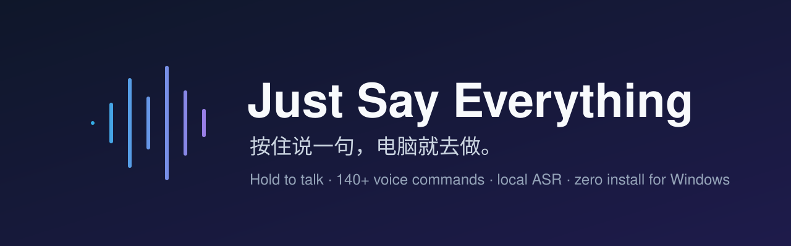

<p align="center"></p>

<p align="center"><b>Hold a key, say it, and Windows does it.</b><br>
Turns push-to-talk dictation into push-to-talk <i>commands</i>: say <code>open WeChat</code>, <code>screenshot</code>, <code>lock screen</code> or <code>next video</code>, and it happens. Not a command? The text goes back to where you were typing, as if nothing changed.</p>

<p align="center"><a href="README.md">中文</a> · <a href="docs/COMMANDS.md">All commands (Chinese)</a></p>

---

## Why

Bluetooth voice remotes (like Xiaomi's) paired with the SayAll app and WeChat IME give you hold-to-dictate on Windows, but they only ever *type*. I wanted to lie on the couch and say "open Douyin", "next", "like", "lock screen". This is a small tray companion that sits next to your dictation tool: it never modifies SayAll or the IME, it just catches the text the moment you press the voice key and decides whether it's a command.

No remote? Any hold-to-talk hotkey works (default `Left Ctrl + Left Win`, configurable), and `Ctrl + Alt + M` lets you type a command directly.

## Features

- **140+ built-in commands**: apps, windows, system actions, editing shortcuts, web search, plus dynamic ones such as "open <anything in your Start menu>" and "<site> <query>".
- **Forgiving matching**: filler words are stripped, pinyin sound-alikes are corrected, aliases + prefix + Dice similarity scoring. At 0.86 or above it runs at once; below that it shows candidates.
- **Two ears**: besides IME dictation, it listens while the key is held and runs local [SenseVoice](https://github.com/FunAudioLLM/SenseVoice) through [sherpa-onnx](https://github.com/k2-fsa/sherpa-onnx), about 100 ms per phrase and fully offline, as a fallback.
- **Talks back and asks**: "what time is it", "read clipboard". When unsure it asks "did you mean…?" and remembers your answer. Shutdown, restart and sleep always ask first.
- **Chains**: "open WeChat then focus the input box", up to 4 steps.
- **Douyin mode, Claude desktop pinned sessions, localhost dashboards** (`panels.json`).
- **Zero dependencies**: built with the C# compiler that ships with Windows' .NET Framework 4.x into a single ~450 KB exe.
- **Private by design**: the optional activity log stays local (foreground app, window title, shortcut counts), never keystrokes, screenshots or audio, and is deleted after 30 days.

> Commands are currently Chinese phrases. English commands are on the roadmap, and PRs are welcome.

## Quick start

```powershell
git clone https://github.com/707717997/just-say-everything.git
cd just-say-everything
powershell -ExecutionPolicy Bypass -File .\build.ps1 -Install
```

Or grab the exe from [Releases](https://github.com/707717997/just-say-everything/releases). Optional offline ASR setup is in [asr/README.md](asr/README.md).

## Disclaimer

A personal open-source project, not affiliated with Xiaomi, SayAll, WeChat, Douyin or Anthropic. These names are only used to describe compatibility.

## License

[MIT](LICENSE)
