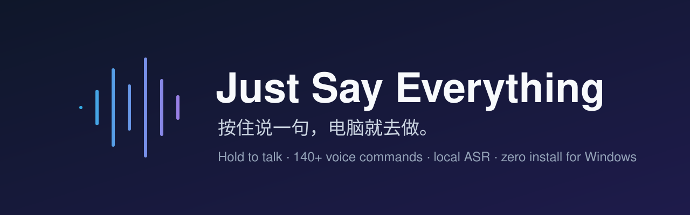
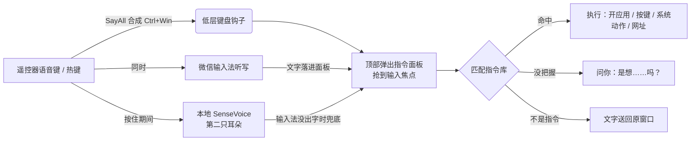

<p align="center"></p>

<p align="center">
  <b>按住说一句，电脑就去做。</b><br>
  把「语音听写」变成「语音指挥」：说 <code>打开微信</code> 就开微信，说 <code>截图</code> 就截图，说 <code>第二个会话</code> 就跳到 Claude 的置顶会话。<br>
  说的不是指令？文字照旧打进原来的输入框，平时听写一点不受影响。
</p>

<p align="center">
  
  
  
  
  
</p>

<p align="center"><a href="README.en.md">English</a> · <a href="docs/COMMANDS.md">全部指令</a> · <a href="docs/使用说明.md">完整使用说明</a></p>

---

## 为什么做这个

买了一个带语音键的蓝牙遥控器（小米语音遥控器这类），配合「无线麦 SayAll」和微信输入法，按住就能听写。可它只会**打字**。

我想要的是：躺在沙发上按住遥控器说一句「打开抖音」「下一个」「点赞」「锁屏」，电脑就照做。于是写了这个伴随程序——**不改 SayAll、不改输入法**，只在你按下语音键的那一刻把文字接过来，判断是不是指令。

> 没有遥控器也能用：任何「按住说话」的热键都行（默认 `左Ctrl + 左Win`，可改），也可以 `Ctrl + Alt + M` 直接打字执行。

## 它能做什么

| | 说什么 | 发生什么 |
| --- | --- | --- |
| 🚀 开程序 | 「打开微信」「打开豆包」 | 内置常用软件；没内置的去开始菜单 + 注册表的**应用索引**里找最像的 |
| 🪟 管窗口 | 「回到桌面」「切回去」「最大化」「窗口置顶」 | 系统级窗口操作 |
| ⌨️ 当快捷键 | 「复制」「撤销」「保存」「新标签页」 | 42 条编辑指令、10 条窗口指令 |
| 🔒 系统 | 「锁屏」「静音」「音量大一点」「截图」 | 关机/重启/睡眠**一定先问你** |
| 🌐 上网 | 「打开 bilibili.com」「淘宝 机械键盘」「百度 今天天气」 | 网址直开、站内直搜 |
| 📱 刷抖音 | 「下一个」「点赞」「收藏」「清屏」「快进」 | 只在抖音页面生效，不抢别的程序的「暂停」 |
| 🤖 Claude | 「打开置顶的第二个会话」「第二个会话说了什么」 | 走官方深链跳转，不碰界面自动化 |
| 💬 会回答 | 「现在几点」「电脑状态」「读剪贴板」 | 本机语音朗读，托盘可关 |
| 🔗 连着做 | 「打开微信然后聚焦输入框」 | 用「然后」串起来，最多 4 步 |
| 🧠 会学习 | 没把握时问「你是想……吗？」 | 你确认过的说法会记住，下次直接执行 |

👉 完整 140 条见 [docs/COMMANDS.md](docs/COMMANDS.md)。

## 亮点

- **零安装依赖**：用 Windows 自带的 .NET Framework 编译器构建，一个 450KB 的 exe，没有运行时要装。
- **两只耳朵**：输入法听写之外，按住语音键时还会旁听麦克风，用本地 [SenseVoice](https://github.com/FunAudioLLM/SenseVoice)（经 [sherpa-onnx](https://github.com/k2-fsa/sherpa-onnx)）识别，每句约 100ms，**不联网**。输入法没出字时自动用本地结果。
- **听不准也能对上**：口头禅（「帮我」「一下」「吧」）自动去掉；拼音近音纠错（「迪普西克」→ deepseek）；别名 + 前缀 + Dice 相似度打分，≥0.86 直接执行，否则列候选让你挑。
- **不打扰**：不是指令就把文字原样送回原窗口；面板抢不到焦点时行为和没装一样。
- **指令库可视化编辑**：F1 打开，内置只读、复制后自定义，动作支持打开应用 / 网址 / 组合键 / 输入文字 / 系统动作 / 等待。
- **隐私**：使用记录只存本机（前台程序、窗口标题、快捷键次数），不记打字内容、不截图、不录音，30 天自动删除，托盘一键关。

## 工作原理



## 快速开始

**需要**：Windows 10/11。用遥控器的话再装「无线麦 SayAll」和微信输入法；只用键盘热键可以不装。

```powershell
git clone https://github.com/707717997/just-say-everything.git
cd just-say-everything
powershell -ExecutionPolicy Bypass -File .\build.ps1 -Install
```

- 编译到 `dist\SayAllVoice.exe`，`-Install` 再部署到 `%USERPROFILE%\SayAllVoice` 并替换正在运行的旧版本。
- 也可以直接下载 [Releases](https://github.com/707717997/just-say-everything/releases) 里的 exe 双击运行。
- 托盘右键可以勾「开机启动」。
- 想要本地识别（第二只耳朵），按 [asr/README.md](asr/README.md) 放好模型，大约 230MB。

## 配置

都在 `%APPDATA%\SayAllVoice\`：

| 文件 | 作用 |
| --- | --- |
| `settings.json` | 热键（`hotkey_keys`）、自动执行阈值（`auto_threshold`）、是否只认指令、是否朗读 |
| `commands.json` | 你自己加的指令（指令库里编辑即可，升级不丢） |
| `panels.json` | 本机网页面板，可选，见下 |
| `learned.json` | 你确认过的说法 |
| `sayallvoice.log` | 运行日志，出问题先看这里 |

**本机网页面板**：常开 `localhost` 服务的话，写一个 `panels.json`，就能说「打开前端」「打开 3000」，已经开着的标签页会直接切过去：

```json
{
  "panels": [
    { "port": 3000, "label": "前端开发", "aliases": ["前端", "dev"] },
    { "port": 8080, "label": "后台管理", "aliases": ["后台"] }
  ]
}
```

## 诊断

```powershell
SayAllVoice.exe --match 帮我打开一下微信吧   # 只看匹配结果，不执行
SayAllVoice.exe --exec 打开记事本            # 真执行一次
SayAllVoice.exe --pins                       # 列出 Claude 置顶会话（只读）
```

结果写进 `%APPDATA%\SayAllVoice\sayallvoice.log`。

## 路线图

- [ ] 指令库导入导出、分享指令包
- [ ] 不依赖 SayAll 的纯麦克风模式（按住热键直接走本地识别）
- [ ] 更多网站的专属指令（B 站、YouTube）
- [ ] 英文指令

欢迎提 Issue 和 PR，尤其是**你常说但它没听懂的说法**——这类反馈最有用。

## 声明

本项目是个人开源作品，与小米、无线麦 SayAll、微信输入法、抖音、Anthropic 均无关联，相关名称仅用于说明兼容性。

## License

[MIT](LICENSE)
